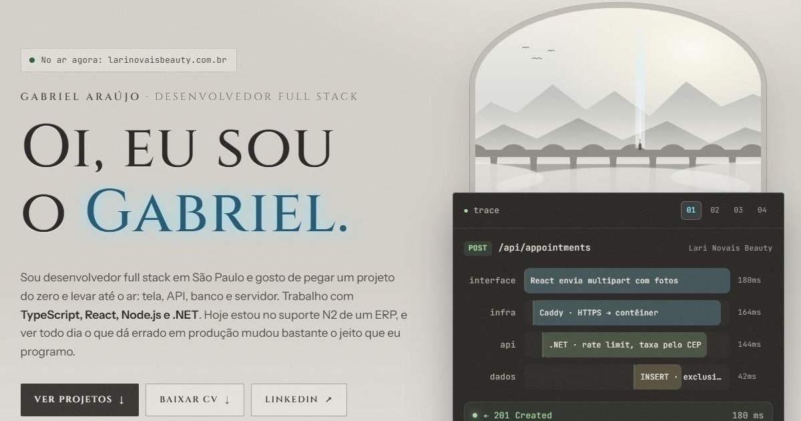

# Portfólio · Gabriel Araújo

Meu portfólio pessoal, feito em **React 19 + TypeScript (strict) + Vite**, sem biblioteca de UI nem de animação.



Em vez de só listar projetos, cada um tem um **laboratório interativo** com a decisão técnica principal funcionando no navegador:

| Projeto | O que dá para testar |
|---|---|
| [Lari Novais Beauty](https://larinovaisbeauty.com.br) | Marcar horários e ver a API responder 201, 409 (exclusion constraint do PostgreSQL) ou 400; calcular a taxa de deslocamento |
| [MHBA](https://makehouseblackagain.netlify.app) | Contagem regressiva ao vivo, notas do Lighthouse e redução de peso da mídia |
| [Bot de suporte ERP](https://github.com/araujogbs/bot-suporte-ERP) | Chat no estilo Discord com os comandos `!buscar` e `!relatoriov8` (dados fictícios) |
| [Lessionato](https://github.com/araujogbs/lessionato-edtech-platform) | Diagrama de sequência do pagamento PIX (mTLS + webhook), passo a passo |

No topo, um "trace" mostra uma requisição de cada projeto atravessando interface, infra, API e banco.

## Detalhes

- Menu de comandos com `Ctrl/⌘ + K` ou `/`
- Currículo em PDF para baixar
- Respeita "reduzir movimento" do sistema e passa em contraste AA
- Responsivo, do celular ao desktop
- Visual inspirado no clima de *Shadow of the Colossus* (névoa, pedra e luz), todo desenhado em CSS e SVG, sem usar arte do jogo

## Rodando

```bash
npm install
npm run dev        # http://localhost:5173
npm run build      # typecheck + build em dist/
npm run preview
```

## Estrutura

```
src/
├── data/          # conteúdo: perfil, experiência, projetos e cenários do trace
├── components/    # seções da página, cada uma com seu CSS
│   └── labs/      # os laboratórios interativos de cada projeto
├── hooks/         # reveal no scroll, "reduzir movimento", relógio
├── lib/           # clipboard e scroll
└── styles/
    ├── global.css # tokens (cores, fontes) e base
    └── theme.css  # camada visual, carregada por último
```

Para trocar textos, projetos ou prints, basta editar `src/data/` e `public/img/`.
O currículo fica em `public/cv/Gabriel-Araujo-CV.pdf`.

## Publicando

`dist/` é estático e pode ir para Cloudflare Pages, Netlify ou Vercel.
Depois de ter o domínio, troque o `og:image` do `index.html` pela URL absoluta da imagem.
